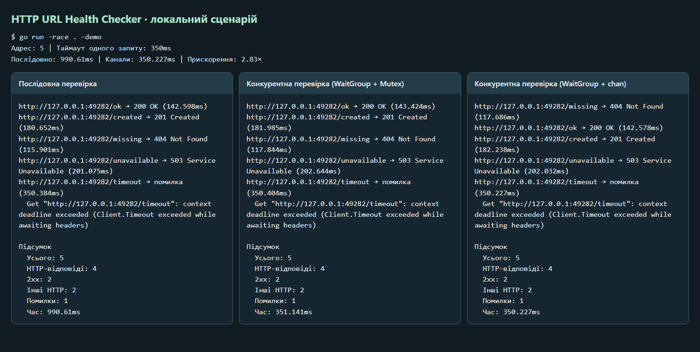

# Практична робота № 1. HTTP URL Health Checker на Go

Консольна утиліта перевіряє HTTP-адреси, вимірює час до отримання заголовків і підраховує відповіді `2xx`, інші HTTP-статуси та помилки запитів. Однаковий перелік адрес можна перевірити послідовно, конкурентно з м’ютексом або конкурентно з каналом.

## Запуск

Потрібен Go 1.22 або новіший. Команди запускай із кореня проєкту:

```powershell
go run . -demo
```

Деморежим відкриває локальний HTTP-сервер і перевіряє п’ять маршрутів. Вони повертають `200 OK`, `201 Created`, `404 Not Found`, `503 Service Unavailable` і контрольований таймаут. Підключення до інтернету для демо не потрібне.

```powershell
go run .
go run . -mode channel -timeout 2s https://go.dev https://github.com https://example.invalid
```

Без URL і `-demo` використовується вбудований список із п’яти адрес, серед яких є реальні сайти, маршрут для перевірки `404` і контрольний домен `.invalid`. Усі прапорці слід ставити перед URL. Типовий таймаут одного запиту становить `3s`, у деморежимі `350ms`.

## Режими

| Значення `-mode` | Як відбувається збір результатів |
| --- | --- |
| `sequential` | Цикл перевіряє адреси по черзі через інтерфейс `Checker`. |
| `mutex` | Окрема горутина на адресу. `WaitGroup` очікує завершення, `Mutex` захищає підсумкові лічильники. |
| `channel` | Горутини передають структури `Result` у канал. Координатор очікує через `WaitGroup` і закриває канал. Головний потік читає його через `range` і підраховує статистику. |
| `all` | Типовий режим. Запускає всі три варіанти й показує відношення часу послідовної перевірки до часу режиму з каналом. |

Кожен режим отримує новий HTTP-клієнт із тим самим таймаутом. Порівняння вимірює повний час опитування адрес і збору результатів, а друк звіту відбувається після заміру. Режим із каналом показує адреси в порядку отримання результатів.

Утиліта записує початковий статус редиректу `3xx` і не переходить за `Location`. `404` та `503` зараховуються як отримані HTTP-відповіді. Невалідні URL, таймаути й інші збої запиту підраховуються окремо. Для діагностики доступності достатньо заголовків, тому тіло відповіді закривається відразу.

## Перевірка

```powershell
go test ./...
go vet ./...
go build ./...
```

Автоматичні тести перевіряють HTTP-статуси, редирект, таймаут, невалідну адресу та підрахунок для 100 результатів у кожному режимі. На Windows для детектора гонок потрібні CGO та сумісний MinGW-w64 `gcc` у `PATH`.

```powershell
$env:CGO_ENABLED = '1'
go test -race -count=3 ./...
go run -race . -demo
```

У виміряному локальному прогоні послідовна перевірка тривала 990,61 мс, режим з `Mutex` — 351,14 мс, а режим із каналом — 350,23 мс. Прискорення режиму з каналом становило **2,83×**. Усі три режими отримали дві відповіді `2xx`, дві інші HTTP-відповіді та один очікуваний таймаут. У зовнішній перевірці три сайти повернули `200`, тестовий маршрут повернув `404`, а для `.invalid` отримано помилку DNS. Три прогони тестів і локальне демо з `-race` завершилися без попереджень про гонки.

Зображення сформовано з фактичного виводу термінала.



- [Вивід тестів із детектором гонок](docs/screenshots/tests.png)
- [Перевірка п’яти стандартних адрес](docs/screenshots/external.png)

## Контрольні питання

1. **Як Go реалізує інтерфейси?** Тип задовольняє інтерфейс, якщо його набір методів відповідає контракту. Окреме оголошення `implements`, як у Java, не потрібне.
2. **Чим відрізняються одержувачі за значенням і за вказівником?** Одержувач за значенням отримує копію значення. Одержувач за вказівником дає доступ до вихідного об’єкта й дозволяє змінювати його поля. Методи з вказівниковим одержувачем також впливають на набір методів, потрібний для інтерфейсу.
3. **Чому багато горутин потребують менше ресурсів, ніж багато потоків ОС?** Горутини мають невеликі початкові стеки, які зростають за потреби. Планувальник Go розподіляє їх між потоками ОС. Фактичне споживання пам’яті залежить від роботи кожної горутини.
4. **Що виявляє `-race`?** Детектор фіксує одночасні несинхронізовані звернення до тієї самої області пам’яті, коли принаймні одне є записом. Він охоплює код, що виконався під час конкретного запуску.
5. **Для чого `WaitGroup`?** Вона очікує завершення групи завдань. `Add` перед запуском горутини гарантує, що `Wait` врахує завдання, а `Done` позначає його завершення.
6. **Чим відрізняються `Mutex` і канал?** `Mutex` надає винятковий доступ до критичної секції зі спільним станом. Канал передає результати споживачу, який може одноосібно оновлювати статистику.
7. **Що станеться під час запису в закритий канал або повторного `close`?** Обидві операції спричинять паніку. У проєкті канал закриває один координатор після завершення всіх відправників.

Джерела для контрольних питань. [Go `net/http`](https://pkg.go.dev/net/http), [Go `sync`](https://pkg.go.dev/sync), [детектор гонок Go](https://go.dev/doc/articles/race_detector).
